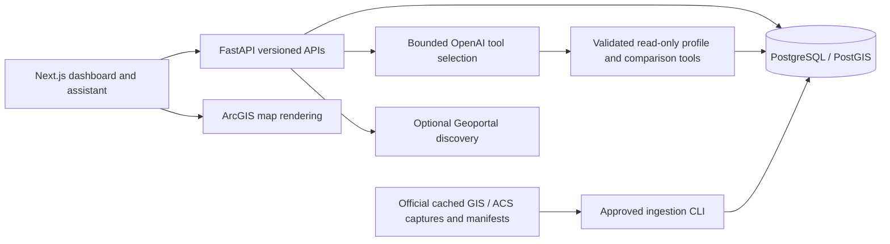

# DistrictIQ Hawaiʻi

**Know your district. Ground decisions in evidence.**

DistrictIQ is a legislative district research application for the **2026 Hawaiʻi Annual Innovation Challenge**, addressing **“Know Your District: An AI Agent for Hawaiʻi's Legislative District Resident Profiles.”** It helps legislators, government officials, policy analysts, researchers and public agencies understand residents, compare places and investigate community needs using traceable public data.

Select a House or Senate district on the map to view demographics, then ask follow-up questions through the AI Assistant. Statistical answers come from PostgreSQL records with source citations and margins of error. A small official program directory provides discovery information; it does **not** determine anyone's eligibility.

Repository: [HAIC-2026/DistricIQ](https://github.com/HAIC-2026/DistricIQ). The application name is DistrictIQ Hawaiʻi.

## Current capabilities

- All **51 House and 25 Senate districts** from the official 2022 legislative plan, stored and validated in PostGIS.
- District maps, selection/highlighting, dashboard cards, charts, choropleths, and supported county/state comparisons.
- Official **2024 ACS five-year profiles**, covering **2020–2024**, for districts, five counties and Hawaiʻi statewide.
- **44,444 original profile observations**, **3,772 mapped dashboard statistics**, and **17,138 additional detailed-table statistics**. Total statistical records: **20,910**.
- **388 searchable measures**: 46 dashboard definitions, 123 additional reviewed profile measures, 209 detailed-table variables and 10 reviewed calculations. These are measures, not 388 independent subjects; not every original workbook row has been exposed to the chatbot.
- `/assistant` with session history, suggested questions, district context, read-only retrieval and controlled OpenAI tool calling.
- Clear factual answers, prioritized findings, comparison tables, optional supported interpretations, clickable citations and expandable methodology. Values and arithmetic remain server-controlled.
- Original workbook cells or Census variables, estimates/MOEs, universes, reference periods and provenance remain available.
- **16 official program discovery records**, with dated sources, application context and explicitly incomplete eligibility rules.
- Existing Geoportal discovery/Data Explorer, optional DBEDT ingestion and crosswalking foundations remain available independently of the core dashboard.

See [response-quality verification](docs/response-quality-report.md), [research expansion verification](docs/research-expansion-report.md) and [core data methodology](docs/local-data-methodology.md). Reports record the scope and date of their checks; older reports are historical snapshots rather than deployment guarantees.

## Technology and architecture

| Layer | Implementation |
| --- | --- |
| Frontend | Next.js 16, React 19, TypeScript, ArcGIS Maps SDK for JavaScript, TanStack Query, Recharts |
| Backend | FastAPI, Pydantic, SQLAlchemy, official OpenAI Python SDK |
| Database | PostgreSQL 17 / PostGIS 3.5, persistent Docker volume, Alembic migrations through `0003` |
| Data pipelines | Python, GeoPandas/Shapely, pandas/openpyxl/xlrd, approved CLI ingestion and source manifests |
| Quality | pytest, Vitest/Testing Library, Ruff, TypeScript, production Next.js build, GitHub Actions workflow |



The model selects evidence and presentation; the server validates references and renders factual values. It receives no unrestricted SQL or database mutation tool. The core dashboard works without OpenAI or live Census requests once data is imported. Discovery and additional data integrations remain optional.

```text
apps/web/          Next.js UI and frontend tests
services/api/      FastAPI, models, Alembic migrations and backend tests
pipelines/         Existing GIS, ACS, program and optional data ingestion
scripts/           Configuration, CLI and verification utilities
data/raw/         Small official source captures used for reproducible imports
data/manifests/   Provenance, reviewed sources and program discovery records
data/fixtures/    Public fixtures for deterministic discovery/optional pipeline tests
docs/              Methodology, implementation reports and verification evidence
outputs/           Prior data requirements research and acquisition recommendations
.github/workflows/ Automated test/build workflow
```

## Local setup

Tested development runtimes: **Python 3.12**, **Node.js 24/npm**, Docker Desktop with Docker Compose v2, and `make`. Start Docker Desktop before starting the database. Docker is not installed by the project.

### Fresh clone

```bash
git clone https://github.com/HAIC-2026/DistricIQ.git
cd DistricIQ
make install PYTHON=python3.12
docker compose up -d --wait db
make migrate
make seed
```

`make install` creates a Python virtual environment, installs the locked backend/frontend dependencies, and runs `make configure`. Configuration generates a random development database password in an ignored root `.env`; it preserves an existing `.env` and never prints the generated credential.

`make seed` imports the checked-in legislative boundaries and four ACS profile workbooks. To reproduce the assistant's full current dataset, import the five cached detailed tables and the program manifest:

```bash
for table in B17001 B25070 B25007 B25011 B19037; do
  make ingest-detailed TABLE="$table"
done
make ingest-programs
```

These imports reuse cached official captures and are idempotent. No live API key or additional download is required for these cached imports. **An existing populated checkout does not need to reimport data to restart.** Never replace its database password or delete its Docker volume as a restart step.

The Compose database image is `postgis/postgis:17-3.5` with `linux/amd64` specified; Apple Silicon uses Docker's amd64 emulation. Volume names are scoped to the Compose project directory unless `COMPOSE_PROJECT_NAME` is explicitly set. The existing original checkout uses `haic26_pgdata`; a clone in another directory normally has a separate volume. Keep project/volume naming stable when reopening an existing database.

### Environment configuration

Edit the ignored root `.env` locally. Names below are configuration variables, never actual credential values. [.env.example](.env.example) contains only empty secret fields/placeholders and public development defaults.

| Variables | Purpose / requirement |
| --- | --- |
| `POSTGRES_DB`, `POSTGRES_USER`, `POSTGRES_PASSWORD`, `DATABASE_URL` | Database configuration; generated for native local API access. Compose overrides the database host to its `db` service. Preserve credentials for initialized volumes. |
| `OPENAI_API_KEY` | Private server-side key required for conversational model calls; optional for the dashboard and normal automated tests. |
| `OPENAI_MODEL` | Server-side model selection; the existing configured model is retained. |
| `CENSUS_API_KEY` | Private, activated Census key required only for live data-query refreshes; cached ingestion does not need it. |
| `APP_NAME`, `APP_ENV`, `DEBUG` | Application settings. |
| `CORS_ORIGINS` | Allowed frontend origins for local API access. |
| `HOUSE_DISTRICT_LAYER_URL`, `SENATE_DISTRICT_LAYER_URL` | Official boundary source endpoints for inspection/refresh. |
| `GEOPORTAL_BASE_URL`, `GEOPORTAL_SEARCH_API`, `GEOPORTAL_DCAT_URL` | Optional source-discovery endpoints. |
| `NEXT_PUBLIC_API_URL` | Public browser API base URL. Production frontend builds capture this value at build time. |
| `NEXT_PUBLIC_ARCGIS_API_KEY` | Optional public browser-scoped ArcGIS configuration; public legislative layers do not require a private server key. Use origin restrictions if configured. |

**Every `NEXT_PUBLIC_*` value is public. Never put OpenAI, Census, database or other private credentials in one.** Restart FastAPI after changing server configuration. Do not paste real credentials into issues, reports or commit messages.

### Run the application

In one terminal:

```bash
make dev-api
```

In a second terminal:

```bash
make dev-web
```

| URL | Purpose |
| --- | --- |
| [localhost:3000](http://localhost:3000) | Dashboard |
| [localhost:3000/assistant](http://localhost:3000/assistant) | AI Assistant |
| [localhost:8000/docs](http://localhost:8000/docs) | FastAPI/OpenAPI documentation |
| [localhost:8000/healthz](http://localhost:8000/healthz) | Process/configuration health |
| [localhost:8000/readyz](http://localhost:8000/readyz) | Database, PostGIS and migration readiness |

To check a production frontend build instead of the development process:

```bash
npm --prefix apps/web run build
npm --prefix apps/web run start -- --hostname 127.0.0.1
```

Use one frontend process on port 3000. The full Compose application build workflow remains available through `make dev`; the verified local development path uses Docker for PostGIS and native Python/Node for the app. This is a local development setup, not a hardened public deployment.

Stop native frontend/backend processes with Ctrl+C in their terminals, then run `docker compose stop db`. Stopping preserves imported data. **Do not use `docker compose down -v` to stop or restart the app.**

## Data sources and reproducibility

| Dataset | Checked-in location | Coverage |
| --- | --- | --- |
| Official 2022 House/Senate boundaries | `data/raw/geography/house-2022.geojson`, `senate-2022.geojson`; `data/manifests/` | 51 House / 25 Senate districts; normalized IDs such as `house-30`, `senate-15` |
| 2024 ACS DP02–DP05 profiles | Four `acs2024_5yr_*_hi.xlsx` workbooks in `data/raw/acs/` | House, Senate, county and state; 2020–2024 estimates/MOEs |
| ACS B17001 | `data/raw/acs/2024/detailed/B17001/` | Sex/age/poverty cross-tabulation |
| ACS B25070 | `data/raw/acs/2024/detailed/B25070/` | Gross rent as a percentage of household income |
| ACS B25007 | `data/raw/acs/2024/detailed/B25007/` | Housing tenure by age of householder |
| ACS B25011 | `data/raw/acs/2024/detailed/B25011/` | Tenure, household type, living arrangements and age of householder |
| ACS B19037 | `data/raw/acs/2024/detailed/B19037/` | Age of householder by household income |
| Official program discovery manifest | `data/manifests/government-programs.json` | 16 state/federal programs; dated references and incomplete rule status |

Detailed-table captures include metadata and House/Senate/county/state responses, covering 82 geographies. Source checksums, geographic IDs, definitions and raw annotations remain available. Official source entry points include the [Hawaiʻi Geoportal](https://geoportal.hawaii.gov/), [House boundary service](https://geodata.hawaii.gov/arcgis/rest/services/AdminBnd/MapServer/33), [Senate boundary service](https://geodata.hawaii.gov/arcgis/rest/services/AdminBnd/MapServer/34) and [2024 ACS API catalog](https://api.census.gov/data/2024/acs/acs5.html).

Small public source captures and reviewed reports are intentionally versioned so a clone can reproduce the working dataset. Source terms and provenance remain applicable; the repository's MIT license does not replace third-party data terms. Public fixtures for optional DBEDT/discovery tests are not evidence that those datasets have been imported into the production district profiles. Do not commit database dumps, individual records or confidential data.

### Known analytical limits

- A five-year ACS estimate is a period estimate, not an annual trend. Pre-2022 same-number districts may have different boundaries.
- People, households, householders, families and housing units are different statistical universes. Social Security or SSI receipt does not establish primary income dependence or identify only kūpuna.
- Separate totals cannot establish an unreported combined subgroup, program eligibility or an unduplicated count of residents at risk.
- Unavailable/suppressed values remain unavailable rather than zero. Some original dashboard count fields remain unavailable even where separately defined detailed-table counts exist in research retrieval.
- MOEs are preserved. Reviewed derived MOEs are approximate; comparisons are descriptive and do not establish statistical significance or causality.
- County benchmarks follow a documented regional-context rule; they are not district estimates or exact county-remainder statistics. Multi-county contexts remain explicit.
- Program discovery records retain their source verification dates and incomplete criteria. They do not establish individual eligibility, current capacity, district participation or guaranteed open applications.
- Dynamic indicator retrieval covers reviewed definitions, not every conceivable demographic question. No unrestricted model-generated SQL, arbitrary calculation or district-level PUMS inference is supported.

## Development progress checklist

Checked items mean **Completed and verified**, with evidence in the linked reports/tests. Unchecked items mean **Not yet completed**. An unchecked item marked **In Progress** has partial implementation and remains unfinished. Update the status only after verification; add the evidence/date when completing a task.

### Project setup and architecture

- [x] Next.js/FastAPI monorepo, dependency locks and local development commands.
- [x] Docker PostGIS configuration, persistent volumes and Alembic migrations.
- [x] Server-side private credentials, ignored local environment files and sanitized application errors.
- [ ] **In Progress** — Team GitHub CI workflow and contribution guide; workflow execution and branch protection/review settings require repository verification/configuration.
- [ ] Hosted staging/production environments and automated deployment.

### Legislative district GIS integration

- [x] Import and validate all 51 House / 25 Senate official 2022 districts.
- [x] Preserve district IDs, geometry source metadata and boundary vintage.
- [x] ArcGIS map, House/Senate selection, highlighting and geographic lookup.
- [x] Same-chamber neighbor discovery from existing PostGIS boundaries.
- [ ] **In Progress** — Existing crosswalk foundations; production use of additional geographic allocation sources is not implemented/verified.

### Census and demographic data acquisition

- [x] Import the four official 2024 ACS profile workbooks and retain original observations.
- [x] Import and reconcile B17001, B25070, B25007, B25011 and B19037 directly for supported geographies.
- [x] Preserve estimates, MOEs, nulls, universes, source variables/cells and reference periods.
- [x] Reviewed metadata search and 10 deterministic derived measures.
- [ ] **In Progress** — Expand indicator coverage beyond the reviewed registry and prioritized acquired tables.
- [ ] Compatible historical series and validated demographic trend analysis.

### Database integration

- [x] FastAPI profiles, sources, research indicators and comparisons read PostgreSQL.
- [x] PostGIS health/readiness, migration checks and idempotent ingestion.
- [x] Separate legislative, county and statewide records with documented context rules.
- [ ] Production backup/restore drills, durable operational monitoring and recovery policy.

### AI assistant and response generation

- [x] `/assistant`, dashboard-to-chat navigation, selected district and session follow-ups.
- [x] Strict read-only tools, validation, request limits/timeouts and safe failure states.
- [x] Grounded statistics, source citations, MOEs, original metadata and missing-data explanations.
- [x] Concise direct answers, prioritized contextual findings and comparison tables.
- [x] Clickable inline references, expandable methodology and optional evidence-supported interpretation.
- [x] Seven response-quality scenarios tested with the live model and database; existing 30-question evaluation recorded.
- [ ] **In Progress** — Broader semantic/compound-question coverage and ongoing representative model evaluation.

### Dashboard and data visualization

- [x] Population, income, poverty, age and housing dashboard indicators.
- [x] Charts, choropleth values/legends and county/state comparisons.
- [x] Source/provenance views and explicit unavailable values.
- [ ] Full accessibility audit and complete device/browser regression coverage.

### Government assistance program matching

- [x] Import and query 16 dated official program discovery records.
- [x] Show official documentation/application links and incomplete eligibility warnings.
- [ ] **In Progress** — Verify/encode complete program-specific eligibility and effective-date rules.
- [ ] Transparent deterministic eligibility screening, with agency confirmation and individual consent/context.
- [ ] Administrative participation data and valid underserved-population analysis.
- [ ] Service-location coverage and program-to-district need explanations with documented methods.
- [ ] Assess document retrieval/RAG only where unstructured documents create a demonstrated need.

### Testing, validation and deployment

- [x] Backend/frontend automated tests, TypeScript, Ruff and production build checks.
- [x] Real PostGIS/source reconciliation and preserved-data regression tests.
- [x] Local desktop browser checks of current answer formatting, citations and district changes.
- [x] Pre-publication credential scanning of candidate files, staged content/history and frontend artifacts.
- [ ] **In Progress** — CI checks running on the team repository and required before merge.
- [ ] Public deployment hardening: authentication/access policy, HTTPS, centralized rate limiting/auditing and monitoring.
- [ ] Dedicated mobile-device and assistive-technology acceptance for the latest response presentation.

## Test and verification commands

```bash
make test
make lint
make build
```

After populating a **disposable development database** with all cached data:

```bash
RUN_SEEDED_TESTS=1 make test-integration
make validate-geography
make validate-statistics
```

The full integration suite includes reimport-idempotence tests. Use an isolated database for these checks, rather than a shared or production database. `make validate-crosswalk` covers optional crosswalk foundations; it does not establish a production geographic allocation capability.

Live model evaluations are optional, require the private server key and incur API charges:

```bash
make verify-assistant
make verify-research
.venv/bin/python scripts/verify_response_quality.py
```

Normal tests and cached data imports do not require OpenAI or Census keys. The [response-quality report](docs/response-quality-report.md) distinguishes deterministic tests, actual live calls, browser observations and remaining limitations. Do not interpret a passing sample as universal model accuracy.

## Collaboration and security

See [CONTRIBUTING.md](CONTRIBUTING.md). Use focused branches and pull requests, retain teammates' commits, and update the checklist with verified evidence. Do not force-push shared branches. Branch protection and required reviewers are repository settings; documentation alone does not enable them.

Before committing:

```bash
.venv/bin/python scripts/check_secrets.py
.venv/bin/python scripts/check_secrets.py --staged --bundles
.venv/bin/python scripts/check_secrets.py --history HEAD
```

The scanner reports locations and categories without exposing matched values. It checks locally configured private credentials and common token/private-key patterns; human review remains necessary. If a real secret was committed, stop publishing and rotate/revoke it even if subsequently deleted.

Dependencies, virtual environments, local `.env` files, build output, caches, logs, database dumps and scratch `work/` files are ignored. `.env.example`, public captures, reviewed reports, source code, tests and lockfiles are intended for version control.

## License

The existing [MIT license](LICENSE), copyright HAIC-2026, is preserved. Public datasets retain their respective source terms and attribution requirements.
