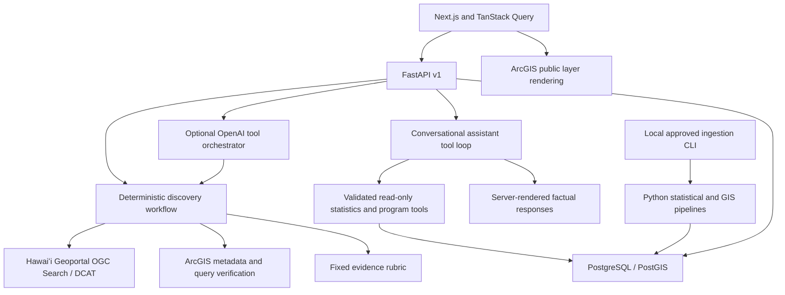

# Architecture

AI and raw statistical processing are separate. The Geoportal discovery tools and the conversational assistant use separate Pydantic-validated read-only tool registries. The assistant searches reviewed statistical metadata, retrieves original observations, compares compatible measures and discovers program records; values, calculations and factual citations are rendered by the server. The discovery tools operate through Pydantic-validated backend functions. The model may select recorded criterion evidence; the response assembler only displays those recorded strings. It cannot change ranking, publish data or import a source.

Discovery remains independent of database readiness. Its audit reports are stored in a bounded local metadata cache (200 reports), not silently described as a production database audit. District profiles and statistical provenance use PostgreSQL and fail explicitly if it is unavailable. A source/evaluation schema is also available for durable deployment integration; metadata-cache retention is the current local workflow.

Geography imports record the inspected source, approved fingerprint and raw-response checksum. All 76 districts are validated before the transaction begins. ACS imports fetch and validate all requested geographies before a single atomic write. DBEDT uses a separately reviewed workbook checksum. No ingestion is exposed over HTTP.

Runtime concurrency is bounded for discovery requests. This MVP uses a single-process, in-memory request limit; multi-worker deployment needs an edge request limit and centralized operational audit retention. No Celery, Redis, Kubernetes, MCP server or multi-agent infrastructure was introduced.
