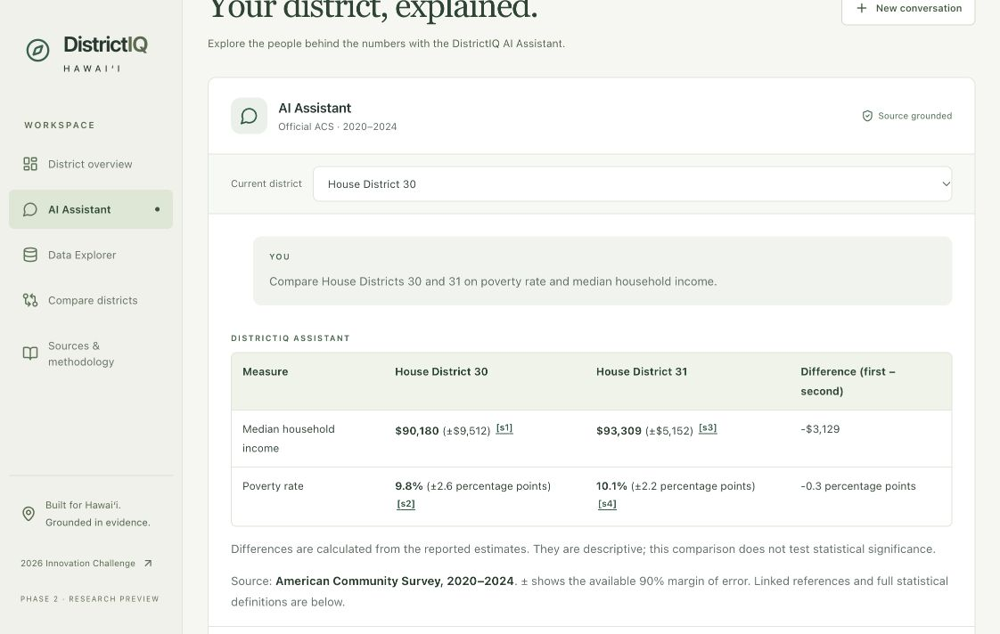

# DistrictIQ response quality implementation report

Implemented and verified October 27, 2026 (Hawaiʻi time).

## Result

The existing `/assistant` now presents retrieved evidence as concise research answers. Simple questions lead with the requested value; contextual questions explain the missing measure and prioritize relevant findings; district comparisons use tables. Sources, margins of error, statistical universes and original provenance remain attached to every selected estimate.

The dashboard, ingestion pipelines, database schema and OpenAI model were preserved. No dependency, migration, data import or new service was added.

## Response behavior

- The model selects relevant evidence, presentation (`brief`, `key_findings`, `table`), an optional supported interpretation, and an optional specific follow-up. It also selects the relevant retrieved program IDs. These choices are part of the running tool schema, not a disconnected prompt file.
- Statistics, calculations, geography and citations remain server-rendered. The model cannot inject free-form factual claims, SQL or model-generated arithmetic.
- The selected district and explicit district names continue through the existing retrieval context; history remains session-scoped and bounded.
- Fixed-income context normally uses no more than three findings. Complete older-adult poverty and tenure measures take precedence over incomplete source subgroups. An answer mismatch prompts a bounded corrective tool turn.
- A household total stays a household total. Income receipt is not primary dependence; no joint subgroup count is inferred from separate totals.
- Routine source details appear in expandable panels. Material limits remain in the answer, including person/household distinctions, missing joint measures, approximate derived MOEs, single-period limits and descriptive comparisons.
- The ACS period appears once per statistical answer. Values retain available MOEs; percentage MOEs explicitly say percentage points. Reported and calculated figures remain distinguishable.
- Optional interpretation is limited to categories supported by selected evidence. The reviewed older-householder owner/renter pair can receive a descriptive higher-estimate statement only with compatible geography, units and period. No significance or causal claim is implied.
- Markdown rendering supports readable paragraphs, emphasis, bullets and tables. Inline references open and focus the correct source panel. Raw HTML and untrusted external links stay inert.

## Files created or modified

| File | Change |
| --- | --- |
| [services/api/app/ai/district_assistant.py](../services/api/app/ai/district_assistant.py) | Updated role and response instructions, evidence priorities, presentation choices, concise selection checks and unchanged bounded tool loop. |
| [services/api/app/ai/response_presenter.py](../services/api/app/ai/response_presenter.py) | New evidence-only prose composer: direct answers, prioritized findings, comparison tables, optional interpretation/follow-up, concise material limits and expandable methodology. |
| [services/api/app/ai/answer_policy.py](../services/api/app/ai/answer_policy.py) | Checks complete age-by-tenure totals and rejects narrow sex/age poverty cells for broad income context; recognizes evicted questions and explicit exhaustive requests. |
| [services/api/app/ai/district_tools.py](../services/api/app/ai/district_tools.py) | Exposes presentation choices in the existing strict present_answer schema; all optional choices are required nullable properties in the OpenAI tool contract. |
| [services/api/app/schemas/assistant.py](../services/api/app/schemas/assistant.py) | Adds optional layout, interpretation, follow-up and retrieved program selection fields to the internal answer selection. |
| [apps/web/components/assistant/Assistant.tsx](../apps/web/components/assistant/Assistant.tsx) | Connects formatted answers, inline source targets, original definitions/methods and collapsible methodology to the existing chat. |
| [apps/web/components/assistant/AnswerText.tsx](../apps/web/components/assistant/AnswerText.tsx) | New restricted Markdown renderer for paragraphs, bold, bullets, tables, verified citation links and retrieved program links. No raw HTML or arbitrary links. |
| [apps/web/app/globals.css](../apps/web/app/globals.css) | Answer spacing, readable tables, source emphasis and contained horizontal table scrolling. |
| [apps/web/types/assistant.ts](../apps/web/types/assistant.ts) | Additive optional methodology response field. |
| [services/api/tests/test_response_presentation.py](../services/api/tests/test_response_presentation.py) | New deterministic tests covering the seven response categories, selection limits, source safety and compatible tenure interpretation. |
| [services/api/tests/test_answer_policy.py](../services/api/tests/test_answer_policy.py) | Regression tests for complete older-adult measures. |
| [services/api/tests/test_assistant.py](../services/api/tests/test_assistant.py) | Updated readable-value and missing-data contracts without changing grounding requirements. |
| [services/api/tests/test_assistant_database.py](../services/api/tests/test_assistant_database.py) | Retains actual PostgreSQL/source-cell assertions with updated plain-language MOE wording. |
| [services/api/tests/test_research.py](../services/api/tests/test_research.py) | Checks contextual answerability and statistical limits without requiring the old robotic opening. |
| [services/api/tests/test_programs.py](../services/api/tests/test_programs.py) | Tests selected retrieved programs, source routes and incomplete eligibility warnings. |
| [apps/web/tests/answer-text.test.tsx](../apps/web/tests/answer-text.test.tsx) | New semantic formatting, table, source navigation and untrusted content tests. |
| [apps/web/tests/assistant.test.tsx](../apps/web/tests/assistant.test.tsx) | Checks rendered values, expandable methodology and correct citation panels. |
| [scripts/verify_response_quality.py](../scripts/verify_response_quality.py) | New opt-in paid live evaluation with database source reconciliation and scenario-specific response contracts; supports one-scenario rechecks. |
| [scripts/verify_research_assistant.py](../scripts/verify_research_assistant.py) | Existing benchmark checks now accept conversational wording while retaining partial-answer and citation checks. |

## Examples from real retrieved records

These examples come from the live evaluation and were reconciled against PostgreSQL estimates, margins of error and reference periods. Source links resolve to the running local API. No sample values were embedded in application answer templates.

### Simple factual answer

Question: What is the population here?

The estimate for **total population** in **House District 30** is **34,283 people** (±1,935). [s4](http://127.0.0.1:8000/v1/statistics/acs2024-house-30-population/provenance)

Source: **American Community Survey, 2020–2024**. ± shows the available 90% margin of error. Linked references and full statistical definitions are below.

### Related evidence when the exact count is unavailable

Question: How many kupuna in my district live on fixed incomes?

An exact count of residents who depend primarily on fixed or benefit income in **Senate District 15** isn't available in the current data. These related indicators can help describe the financial context.

**Key findings**

- People 65+ below poverty: **897 people** (±164.3) (calculated). [s1](http://127.0.0.1:8000/v1/research/observations/senate-15/older_poverty_count/provenance)
- Households receiving Social Security income: **6,331 households** (±385). [s2](http://127.0.0.1:8000/v1/research/observations/senate-15/dp03_r074_estimate/provenance)
- Households receiving Supplemental Security Income (SSI): **951 households** (±189). [s3](http://127.0.0.1:8000/v1/research/observations/senate-15/dp03_r078_estimate/provenance)

**What this means**

Income-source figures help frame research on financial security and relevant services. Receiving a benefit doesn't establish that it is someone's main income. Household totals include all ages, not individual older residents.

Separate figures can't establish a combined count of residents meeting all the requested conditions.

Calculated figures combine compatible source cells. Their margins of error are approximate because covariance is unavailable; source details show the inputs and formula.

Source: **American Community Survey, 2020–2024**. ± shows the available 90% margin of error. Linked references and full statistical definitions are below.

### District comparison

Question: Compare House Districts 30 and 31 on poverty rate and median household income.

| Measure | House District 30 | House District 31 | Difference (first − second) |
| --- | --- | --- | --- |
| Median household income | **$90,180** (±$9,512) [s1](http://127.0.0.1:8000/v1/statistics/acs2024-house-30-median_household_income/provenance) | **$93,309** (±$5,152) [s3](http://127.0.0.1:8000/v1/statistics/acs2024-house-31-median_household_income/provenance) | -$3,129 |
| Poverty rate | **9.8%** (±2.6 percentage points) [s2](http://127.0.0.1:8000/v1/statistics/acs2024-house-30-poverty_rate/provenance) | **10.1%** (±2.2 percentage points) [s4](http://127.0.0.1:8000/v1/statistics/acs2024-house-31-poverty_rate/provenance) | -0.3 percentage points |

Differences are calculated from the reported estimates. They are descriptive; this comparison does not test statistical significance.

Source: **American Community Survey, 2020–2024**. ± shows the available 90% margin of error. Linked references and full statistical definitions are below.

### Householders versus individual residents

Question: Are older residents in my district more likely to rent or own their homes?

The available data describe households rather than individual residents. Here's the closest household-based evidence in **House District 30**.

**Key findings**

- Owner households with householder 65+: **815 households** (±177.7) (calculated). [s1](http://127.0.0.1:8000/v1/research/observations/house-30/older_owner_households/provenance)
- Renter households with householder 65+: **774 households** (±156.2) (calculated). [s2](http://127.0.0.1:8000/v1/research/observations/house-30/older_renter_households/provenance)

Among households with a householder age 65 or older, the reported **owner-occupied household** estimate is higher. This is a descriptive comparison, without a statistical significance test. [s1](http://127.0.0.1:8000/v1/research/observations/house-30/older_owner_households/provenance) [s2](http://127.0.0.1:8000/v1/research/observations/house-30/older_renter_households/provenance)

These figures count households, families or housing units, not individual residents. Tenure by age refers to the householder's age, not the age of everyone living there.

Calculated figures combine compatible source cells. Their margins of error are approximate because covariance is unavailable; source details show the inputs and formula.

Source: **American Community Survey, 2020–2024**. ± shows the available 90% margin of error. Linked references and full statistical definitions are below.

## Verification

| Check | Result |
| --- | --- |
| Backend unit tests | 126 passed |
| Read-only PostgreSQL/PostGIS integration tests | 20 passed |
| Frontend tests | 24 passed |
| Total automated tests executed | 170 passed |
| Ruff | Passed |
| Frontend lint / TypeScript | Passed |
| Production Next.js build | Passed |
| Seven live model scenarios | All passed source and response contracts |
| Live statistical provenance URLs | 10 distinct URLs returned 200 |
| Selected program detail URLs | 3 returned 200 and matched retrieved official links |
| Service health / readiness / assistant page | 200; database ready and PostGIS available |

Six ingestion-idempotence integration tests were deliberately excluded from this run because ingestion did not change and no reimport was needed. Existing non-failing Starlette/httpx deprecation warnings remain. The live cases call the same production answer service directly; HTTP and browser interactions were checked separately. Affected scenarios were rerun after corrections and merged into the saved seven-case results. This is a qualitative sample, not a universal natural-language accuracy guarantee.

| Live scenario | Result |
| --- | --- |
| exact — What is the population here? | Passed |
| related — How many kupuna in my district live on fixed incomes? | Passed |
| universe — Are older residents in my district more likely to rent or own their homes? | Passed |
| comparison — Compare House Districts 30 and 31 on poverty rate and median household income. | Passed |
| uncertainty — Explain the margin of error for median household income here. | Passed |
| programs — Which official programs support older adults with limited retirement income? | Passed |
| unsupported — How many residents here have been evicted in the last month? | Passed |

### Browser observations

- Verified actual House 30 / House 31 comparison tables with readable monetary values, percentage-point differences and linked source references.
- Verified an inline citation expands and focuses its matching source record, including workbook cells and the original universe.
- Verified the Senate 15 fixed-income context answer with Social Security/SSI household estimates and an older-adult poverty measure.
- Verified changing the selected district from Senate 15 to House 30 makes a subsequent population question return House 30 (34,283 ±1,935).
- Verified bold emphasis, bullet spacing and collapsible source/methodology controls in the existing interface.
- Saved the comparison screenshot below. A separate mobile viewport could not be established by the browser override in this session; dedicated mobile-device verification is not claimed. Table scrolling and narrow-screen layout styles are retained.



### Preserved database inventory

76 legislative districts; 44,444 original ACS observations; 3,772 original mapped statistics; 20,910 total statistics including the previously imported detailed tables; 16 program-directory records; Alembic 0003. No ingestion or migration was run for this change.

## Remaining limitations

- An exact count of older residents depending primarily on fixed income, or an unreported combined subgroup, remains unavailable. Clearer wording does not create new statistical coverage.
- Program records retain their existing verification dates and incomplete-rule status. This task did not refresh program rules, determine individual eligibility, measure service capacity or establish district participation counts.
- Comparisons remain descriptive; no general significance-testing or causal-analysis engine was added. Derived MOEs retain their documented approximation.
- Interpretation categories and reviewed calculations are deliberately bounded. Additional unsupported analysis must fail safely or explain the gap; narrative variety does not override grounding checks.
- Model choices can vary between runs. Deterministic tests cover the contracts, and the saved live cases cover the requested seven scenarios; neither constitutes exhaustive question coverage.

## Review and rerun

App: [DistrictIQ Assistant](http://127.0.0.1:3000/assistant?district=house-30). FastAPI, Next.js and the existing database were left running for review.

The API endpoint remains `POST /v1/assistant/chat`. `methodology` is an additive optional response field; existing citation and comparison contracts are preserved.

Run deterministic checks:

```bash
cd /Users/gianvelasco/Desktop/HAIC26
make test
make lint
npm --prefix apps/web run build
```

Run the read-only integration suite:

```bash
RUN_POSTGIS_TESTS=1 RUN_SEEDED_TESTS=1 .venv/bin/python -m pytest -c services/api/pyproject.toml services/api/tests -m integration -k 'not reimport and not idempotent'
```

Run live evaluations (uses the existing server-side OpenAI key and makes billed model calls):

```bash
.venv/bin/python scripts/verify_response_quality.py
# Recheck one case while preserving the other saved results:
.venv/bin/python scripts/verify_response_quality.py --scenario related
```

If services have been stopped, use `docker compose up -d db`, then `make dev-api` and `make dev-web` in separate terminals. No reimport or migration is needed for this response-quality change.

## Evidence artifacts

- [Seven live answers and their citations](response-quality-live.json)
- [HTTP checks and preserved database counts](response-quality-http.json)
- [Browser screenshot](response-quality-browser.png)

The strict nullable tool fields follow the [official OpenAI function calling guidance](https://developers.openai.com/api/docs/guides/function-calling). The existing configured model and SDK were retained.
